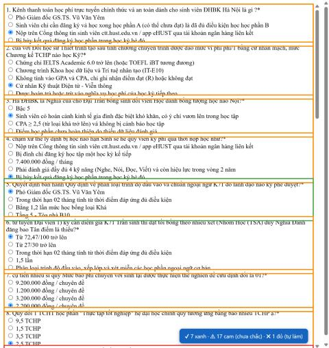

# msforms-autofill

Extension Chrome tự điền đáp án bài **Kiểm tra quy chế kỳ 2026.1 – ĐHBK Hà Nội** trên Microsoft Forms.

> Đã test trên `Chrome` với form thật (200/200 câu khớp file đáp án).



## Mục lục

* [Cài đặt](#cài-đặt)
* [Sử dụng](#sử-dụng)
* [Cập nhật đáp án](#cập-nhật-đáp-án)
* [Kiểm thử](#kiểm-thử)

## Cài đặt

1. Vào [Releases](../../releases), tải file `msforms-autofill_vx.x.x.zip` và giải nén.
   (Hoặc `git clone` repo này.)
2. Mở `chrome://extensions` (Edge: `edge://extensions`).
3. Bật **Chế độ nhà phát triển** (Developer mode).
4. Bấm **Tải tiện ích đã giải nén** (Load unpacked) và chọn thư mục vừa giải nén.

## Sử dụng

1. Mở link form và đăng nhập tài khoản trường.
2. Extension tự chọn đáp án ngay khi câu hỏi hiện ra. Nút góc dưới phải hiển thị số câu theo màu; bấm vào nút để điền lại.
3. Mỗi câu được viền màu. Rê chuột vào câu để xem đáp án đã chọn.

| Màu | Ý nghĩa |
|---|---|
| 🟢 Xanh | Khớp chính xác và đáp án đã xác minh |
| 🟠 Cam | Đáp án **chưa xác minh** (suy luận), hoặc câu hỏi chỉ khớp gần đúng → **nên kiểm tra lại** |
| 🔴 Đỏ | Không có trong file đáp án → tự làm |

4. **Extension không tự nộp bài.** Xem lại các câu cam rồi tự bấm *Gửi*.

### Cơ chế khớp

- Khớp theo **nội dung** câu hỏi và đáp án, không theo vị trí hay chữ A/B/C/D, nên không bị ảnh hưởng khi form xáo thứ tự câu hỏi hoặc thứ tự phương án.
- Khi không khớp chính xác, extension dùng độ giống ký tự (Dice trên cặp ký tự liền nhau, ngưỡng 0,6). Cách này chịu được việc viết lại nhẹ hoặc **đảo trật tự từ** trong câu.
- Ngân hàng có các cặp câu gần giống nhau nhưng đáp án khác nhau. Vì vậy, khi khớp gần đúng, extension chỉ nhận câu nào có đáp án thực sự nằm trong các phương án.

## Cập nhật đáp án

Đáp án được đóng gói sẵn trong `answers.js`. Để dùng file đáp án khác (cùng định dạng `{ "data": [{ "question", "answer", "verified" }] }`):

```bash
node tools/build-answers.mjs path/to/dap_an.json
```

Sau đó bấm **Reload** extension tại `chrome://extensions`.

## Kiểm thử

`test/fixture.html` là trang mô phỏng giao diện Microsoft Forms. Trang tự động:

- xáo thứ tự câu hỏi và phương án;
- xáo ngẫu nhiên các từ trong câu;
- gài bẫy bằng các cặp câu gần giống nhau và các phương án chỉ khác con số;

rồi tự kiểm tra kết quả. Cách chạy:

```bash
python -m http.server 8765
```

Mở `http://localhost:8765/test/fixture.html`: tiêu đề tab hiện `PASS` nghĩa là đạt.

---
*Tham khảo cấu trúc từ [tungnguyensnk/autofillForm](https://github.com/tungnguyensnk/autofillForm).*
